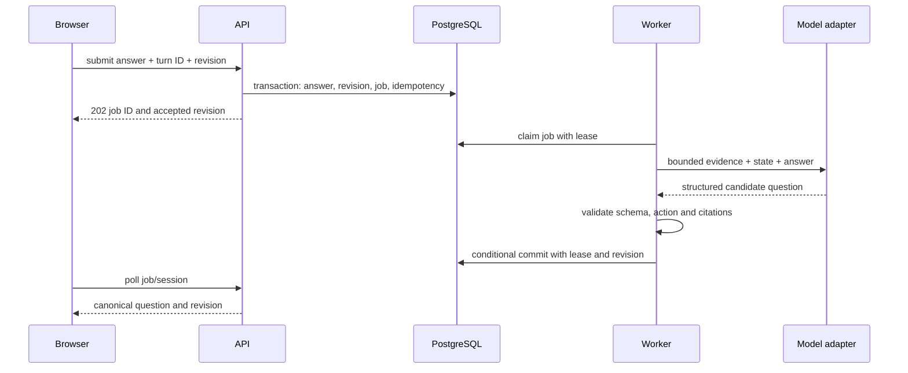

# System architecture
## Default implementation
A TypeScript modular application: Next.js App Router UI/API, a separate long-running Node worker from the same repository, PostgreSQL for data and durable jobs, Prisma for ordinary persistence, explicit SQL for queue claiming. Node 24 LTS baseline; Next.js 16/Prisma 7 family are working defaults. Verify compatibility and pin exact package versions at scaffold time. No floating latest versions in production.

Use browser SpeechSynthesis through an output interface first; paid server TTS is optional. LLM providers live behind an adapter. No fixed model name or purchased provider assumed. Candidate input is text-only at the domain boundary.

The worker avoids depending on an HTTP request surviving an AI operation. Two processes are justified; Redis, vector DB, LiveKit and autonomous agent orchestration are not initial dependencies.

## Modules
| Module | Responsibility |
| --- | --- |
| web | Screens, composer, playback, job polling, accessible errors |
| api | Owner authentication, validation, idempotency, transactions, DTOs |
| domain | Pure interview transitions, budgets, evidence checks, rubric rules |
| ingestion | Normalisation, file checks, excerpts, project-version creation |
| ai | Preparation, turn generation and report prompts plus model adapters |
| jobs | Durable claims, leases, bounded retries and completion commits |
| persistence | Ownership-scoped queries, migrations and retention |
| observability | Redacted events, timings, provider usage and release metrics |

## Data flow

## Durable job protocol
Job kinds: prepare_project, generate_turn, clarify_turn, evaluate_session.
API inserts jobs in the same transaction as their triggering state. Worker claims one ready job using FOR UPDATE SKIP LOCKED, assigns a random lease token, commits, then performs network work outside the transaction. Lease is 120 seconds, renewed every 20 seconds. Provider call deadline is 45 seconds; validation repair allows one further call. Concurrency starts at two jobs per worker.

An expired lease may be reclaimed. A completion transaction requires matching lease token, expected session/version revision and non-deleted owner/project. Superseded jobs are cancelled; late output is discarded. Delivery is at least once; state effects must be idempotent. A crashed provider call can incur duplicate cost, so spend reservation includes retries.

Retry only network/429/5xx failures, at most two automatic retries with bounded jitter. Invalid model output gets one repair attempt, then a validated planned question or explicit failure. A plan/report with invalid evidence is never silently published. User retry requeues the same failed job with a new lease, never duplicates the answer.

GET polling is initially every second, then every three seconds after ten seconds; stop on completion, hidden tab or offline status. Reconnect by fetching canonical snapshots. No WebSocket/SSE requirement in v0.1.

## Context and latency
Preparation builds an index and topic cards asynchronously. The live prompt contains current objective, recent turns, compact claim ledger and relevant evidence; full transcript is retained separately for evaluation. Limit each model request using adapter token counting, not character estimates alone. Preparation can chunk files, merge summaries and validate every evidence reference. Do not solve long projects by silent truncation.

LLM failure does not lose accepted answers. TTS failure never blocks text. Database failure rejects new writes honestly; a browser draft must remain intact. Save output before presenting or speaking it.

## Deployment shape
One public HTTPS web service; one private worker; one PostgreSQL database in the same region. Container-friendly deployment; provider-specific accounts remain undecided. Do not deploy the worker inside a serverless request or use fire-and-forget promises for durable work.

Technical references: [Next route handlers](https://nextjs.org/docs/app/getting-started/route-handlers), [PostgreSQL row locking](https://www.postgresql.org/docs/current/sql-select.html), [Node releases](https://nodejs.org/en/about/previous-releases), [browser speech](https://developer.mozilla.org/en-US/docs/Web/API/SpeechSynthesis).

