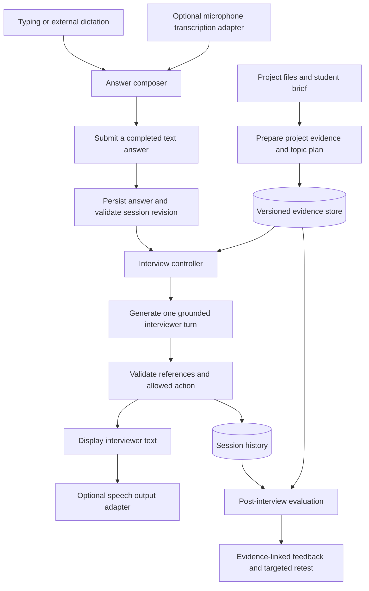

# Defend: research and proposed architecture

Research date: 24 October 2026 (IST).

Status: design proposal, not an implemented or benchmarked system. Reviewed public product documentation, a research paper, open-source architecture documents, and DeepInterview's live state implementation. Did not run third-party products or repositories. Product behaviour does not establish a vendor's private backend design.

## Established product requirements

- Student project-defence practice with an interview-like conversation.
- Questions and follow-ups should use the student's supplied project evidence.
- Dictation is an interchangeable black box. Wispr can supply text, but must not be a runtime dependency.
- Typed input and external dictation must be first-class paths.
- The seven-day hackathon version needs a complete interview and useful debrief, with real classmate feedback.
- Practice and learning are the intended use; this is not an authorship detector or an official grading system.

## Observed patterns

| Reference | Evidence reviewed | Relevant finding |
| --- | --- | --- |
| [Yoodli](https://support.yoodli.ai/en/articles/9550465-practice-with-yoodli) | Official product guide | Interview mode combines preset questions with response-dependent follow-ups; analysis follows the session. Internal architecture is undisclosed. |
| [NYU Viva](https://viva.stern.nyu.edu/) | Official system description | Topic phases and evidence-supported grading are separated. |
| [NYU field report](https://arxiv.org/html/2603.18221v1) | Research paper, especially failure modes | Reports compound questions, changed questions on repetition, and poor handling of thinking pauses. Its initial study involved 36 students; model agreement is not proof of correctness. |
| [DeepInterview architecture](https://github.com/ngoanpv/DeepInterview/blob/main/docs/ARCHITECTURE.md) | Architecture document | Preparation, live interview, and post-processing share structured context; the live loop stays compact; providers use adapters. |
| [DeepInterview state code](https://github.com/ngoanpv/DeepInterview/blob/main/apps/agent/src/deepinterview_agent/live/state.py) | Python implementation | Voice-independent state operations, transcript recovery, and a word-count-based difficulty hint. The latter should not be copied as a competence signal. |
| [InterviewLab](https://github.com/StephaneWamba/InterviewLab) | Repository README | Separates API, conversation orchestration, voice transport, persistence, and sandbox services. Its full stack is larger than this MVP needs. |
| [InterVox](https://github.com/lilhuss26/InterVox) | Repository README/API description | Distinct planner/interviewer/router/evaluator/report responsibilities; its documented audio answer endpoint illustrates coupling we should avoid. |
| [LiveKit pipeline types](https://docs.livekit.io/agents/models/pipelines/) | Official technical documentation | Cascaded transcription, text reasoning, and speech output allow independent providers. |
| [LiveKit turn handling](https://docs.livekit.io/agents/logic/turns/) | Official technical documentation | Explicit/manual turn control is supported alongside automatic detection and interruption handling. |

## Proposed architecture

These are Defend design recommendations, not claims about the products above.



### 1. Prepare the project before the interview

Accept a README and selected source files initially. Bound file sizes and supported formats. Do not execute uploaded code. Treat project text as evidence, never as instructions to the interview system.

Preserve an immutable project version with stable file IDs, line spans, and content hashes. Extract a compact project brief, component/function index, evidence excerpts, and topic candidates. Record missing context explicitly. The student confirms the project summary and their claimed contribution; this is context, not independently verified authorship.

Create topic cards for project purpose, implementation, design choices, failure cases, and improvements. Each card includes evidence IDs, a learning objective, a starting question, and possible follow-up directions. These are hypotheses to investigate, not pre-decided accusations.

For small projects start with symbol/file lookup and bounded excerpts. Add semantic retrieval only if real examples show it is needed. Do not send an entire repository on every turn.

### 2. Keep the interview controller explicit

Track phase, current topic, current question, discussed claims, evidence references, follow-up count, covered objectives, remaining budget, and session revision.

Example phases: introduction -> project walkthrough -> technical depth -> failure scenario -> reflection -> complete.

The model proposes a next action: ask, follow_up, clarify, advance_topic, or finish. The controller validates it against session state. Repeat, pause, resume, and stop can be deterministic controls. A repeat action reuses the exact stored question.

Generate one main question per turn, with at most one short transition. Validate compound requests as well as punctuation; counting question marks alone is insufficient. Allow a bounded retry and a safe planned-question fallback. Bound follow-ups per topic so a conversation progresses.

Keep one main reasoning call per ordinary turn as a starting design. Retrieve evidence before that call where possible. If a claim needs additional evidence, retrieve it or ask for clarification instead of inventing certainty. Measure actual latency before promising a response time.

### 3. Keep transport outside the interview engine

Canonical answer input:

```ts
type SubmittedAnswer = {
  sessionId: string;
  questionId: string;
  turnId: string;
  expectedRevision: number;
  text: string;
};
```

The composer accepts typing, pasted text, or text inserted by Wispr or any other dictation app. Submission is explicit. Do not guess that external dictation ended from text-field inactivity; no microphone state is available through that interface.

Optional built-in transcription can provide draft/final transcript events. Its audio and endpointing lifecycle belongs to its adapter. The core still receives a completed text answer. Stop interviewer playback explicitly before answering; automatic barge-in needs actual microphone events and is a later capability.

Interviewer text is canonical. TTS is replaceable and optional. Audio failure preserves the visible question and session. Do not infer accent, vocal confidence, or fluency from polished dictation text.

### 4. Save data independently of model decisions

Persist each submitted answer before generating the next question. Use turn IDs to deduplicate retries and revisions to reject stale answers. Link every response to the question it answers. A generation failure retries from persisted state without advancing twice.

Store project versions, source excerpts, plans, sessions, answers, interviewer turns, evidence links, and reports. Ordinary database records are sufficient initially; a separate event-stream platform is unnecessary.

### 5. Evaluate after the interview

Use the completed transcript, actual asked questions, rubric, and project evidence. Evaluate implementation understanding, explanation of design choices, reasoning about failures, and recognition of limits.

Each feedback item should contain the relevant answer quote/turn ID, criterion, evidence IDs, rationale, uncertainty, and a next practice task. Distinguish demonstrated, partial, not demonstrated, and not assessed. A skipped or unasked topic is not evidence of ignorance.

Separate supported claims, contradictions, and unresolved claims. A missing check in one handler does not prove it is absent from middleware or another file. Validate citation existence mechanically; whether a citation supports the claim still needs semantic review and human evaluation during the pilot.

Use a separate evaluation prompt/pass initially; independent responsibilities do not require different models or autonomous agents. An optional second pass can audit serious negative findings. More models agreeing is not a substitute for expert checking.

Retest with a fresh scenario linked to the same concept. Keep previous hints visible to the evaluator so coached answers are not treated as unaided performance.

## Product ideas worth pursuing

1. An interviewer can request a code excerpt and ask the student to trace it, creating a concrete project discussion.
2. A debrief opens the exact interview moment and source evidence behind each finding.
3. The student can dispute feedback or supply missing context, producing a revised, traceable assessment.
4. A short second interview targets unresolved concepts with new scenarios.
5. A clear session agenda and thinking/pause control make the experience predictable without scripting every question.

## MVP and deferrals

Build first: selected-file ingestion; confirmed project brief; one grounded interview style; text-first answer contract; optional spoken questions; persistent sessions; evidence-linked debrief; one retest flow; public sample project.

Defer: avatars, emotion analysis, hiring recommendations, arbitrary code execution, multiple autonomous interviewers, full-duplex speech, large-repository graph infrastructure, and institution administration.

Prefer a modular application with a database and replaceable model/TTS clients. A persistent audio service such as LiveKit becomes useful if built-in streaming voice becomes a core feature; it is not required for the external-dictation MVP. A workflow framework is optional: the state transitions should be explicit either way.

## Validation before polishing

- Same submitted text works through typing and external dictation without different interview semantics.
- Repeat preserves wording; pause does not consume an answer; stop ends further questioning.
- Retry does not duplicate an answer or advance the session twice.
- Partial project context produces uncertainty, not a false contradiction.
- Short correct and long incorrect answers are judged on reasoning, not length.
- Every project-specific feedback item points to a valid source and transcript turn.
- A failed TTS request leaves a usable text interview.
- A knowledgeable classmate reviews negative findings for correctness.
- Record median/tail response latency, failed turns, cost per session, useful-follow-up rate, and feedback corrections during real trials.

Open decisions: initial project stack, supported file formats, model/TTS providers, and whether built-in microphone input belongs in the first release. None changes the input-independent core.
